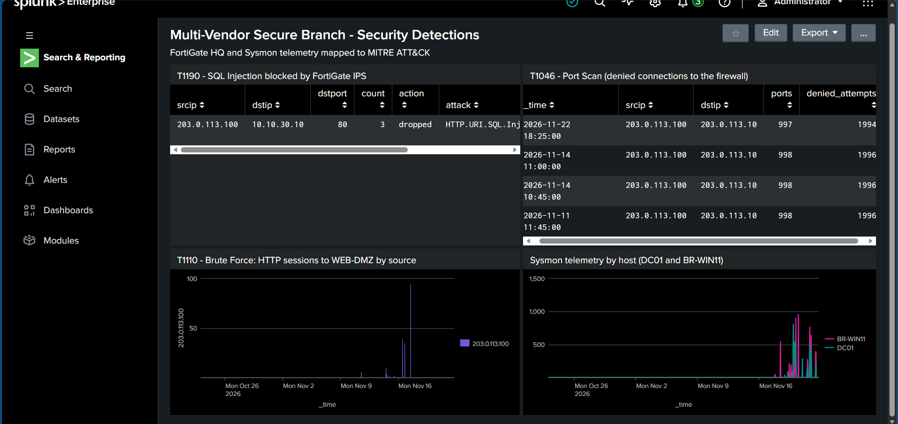

# Multi-Vendor Secure Branch

A hands-on security lab built in EVE-NG: a **FortiGate** headquarters and a **pfSense** branch connected by an IPsec site-to-site tunnel, a Windows domain monitored with **Sysmon**, a vulnerable web server in a DMZ, and **Splunk** collecting logs. A Kali machine simulates attacks, and the detections are mapped to **MITRE ATT&CK**.

> Everything here runs in an isolated lab. The vulnerable application (DVWA) must never be exposed to a real network.

## What this lab demonstrates

- Site-to-site IPsec VPN between two different vendors (FortiGate and pfSense)
- Active Directory domain (`hq.lab`) with a branch Windows 11 client joined across the tunnel
- Web server in a DMZ (nginx + DVWA) published through a FortiGate virtual IP
- FortiGate IPS and Web Filter profile protecting the DMZ policy
- Centralised logging: FortiGate and pfSense syslog, plus Sysmon from the Windows machines through the Splunk Universal Forwarder
- Three attack scenarios detected with Splunk searches and shown on one dashboard

## Topology

### Network zones

| Zone | Subnet | Devices |
|---|---|---|
| HQ | 10.10.10.0/24 | FGT-HQ, SW-CORE, DC01, HQ-PC |
| DMZ | 10.10.30.0/24 | WEB-DMZ |
| SIEM | 10.10.40.0/24 | SPLUNK |
| Branch | 172.16.10.0/24 | PFS-BR, BR-LAN, BR-PC, BR-WIN11 |
| Internet / Attacker | 203.0.113.0/24 | NET-INET, KALI |

The two management clouds in the topology are for administration only and are not part of the lab traffic. The IPsec tunnel between FGT-HQ and PFS-BR runs across the simulated internet (NET-INET).

### Devices

| Component | Role | Notes |
|---|---|---|
| FGT-HQ | FortiGate firewall (FortiOS 8.0.1) | HQ gateway, DMZ policy with IPS and Web Filter, syslog to Splunk |
| PFS-BR | pfSense firewall | Branch gateway, IPsec peer for the branch |
| SW-CORE | Cisco switch | HQ core switching and VLANs |
| BR-LAN | Branch switch | Branch LAN |
| DC01 | Windows Server, Active Directory | Domain `hq.lab`, Sysmon, Splunk Universal Forwarder |
| BR-WIN11 | Windows 11 client | Branch client joined to the domain, Sysmon, Splunk Universal Forwarder |
| HQ-PC, BR-PC | Test clients | Basic endpoints on the HQ and branch networks |
| WEB-DMZ | Ubuntu, nginx + DVWA | Intentionally vulnerable target |
| SPLUNK | Ubuntu, Splunk Enterprise | Log collector and dashboards. Indexes: `network`, `sysmon` |
| KALI | Kali Linux | Attacker on the outside network |

## Log pipeline

| Source | Transport | Index |
|---|---|---|
| FortiGate (traffic, UTM, event) | Syslog UDP 514 | `network` |
| pfSense | Syslog UDP 514 | `network` |
| DC01 and BR-WIN11 (Sysmon) | Splunk Universal Forwarder to TCP 9997 | `sysmon` |

The forwarder configuration is in [`forwarder/inputs.conf`](forwarder/inputs.conf). Only the Sysmon channel is collected, to keep the lab disk small.

## Attack scenarios and detections

| MITRE ATT&CK | Technique | What was run from Kali | Where it is detected |
|---|---|---|---|
| T1046 | Network Service Discovery | `nmap -sS -p 1-1000` against the firewall's public address | FortiGate local-traffic deny logs, about 1,000 denied attempts on roughly 1,000 ports from one source |
| T1110 | Brute Force | Repeated login attempts against the DVWA login page | HTTP sessions from one source to the web server, 30 to 32 sessions per minute |
| T1190 | Exploit Public-Facing Application | SQL injection against DVWA | FortiGate IPS signature `HTTP.URI.SQL.Injection`, action `dropped` |

All the searches are in [`detections/spl-queries.md`](detections/spl-queries.md).

## Dashboard

The dashboard source is in [`splunk/dashboard.xml`](splunk/dashboard.xml). To import it: Splunk Web, Dashboards, Create New Dashboard, choose Classic Dashboards, open Source, paste the file, save.

## FortiGate evidence

The IPS blocked the SQL injection attempts and logged them as high severity:

More detail about the policy and the IPS sensor is in [`fortigate/notes.md`](fortigate/notes.md).

## Problems solved along the way

These are the real issues hit during the build, kept here because troubleshooting is part of the work:

- **Forwarder connected but no data arrived.** The forwarder service on the branch client ran as `NT SERVICE\SplunkForwarder` and could not read the Sysmon event channel (error code 5, access denied). Running the service as `LocalSystem` fixed it.
- **Wrong clock on one VM.** Time was drifting by 11 hours after every restart. The domain controller was set to the right time zone and the client was synced to it with `w32tm`.
- **Events landing in the wrong index.** A forwarder config file had typos and a missing `index = sysmon` line, so events went to `main`. Rewriting `inputs.conf` and cleaning the `main` index fixed it.
- **IPS events missing from Splunk searches.** The firewall was not at fault; the searches were filtering on the wrong values. Running a live test and reading the raw event showed the real field names (`type=utm`, `subtype=ips`, `attack`, `action`).
- **Port scan not visible in forward traffic.** The scan targets the firewall itself, so it appears under `type=traffic subtype=local action=deny`.

## Skills shown

FortiGate administration, IPsec, Active Directory, Sysmon, Splunk (SPL, dashboards, forwarders, indexes), log analysis, MITRE ATT&CK mapping, lab design and troubleshooting.

## Author

Abdullah Badawod ([abadawod.dev](https://abadawod.dev))
